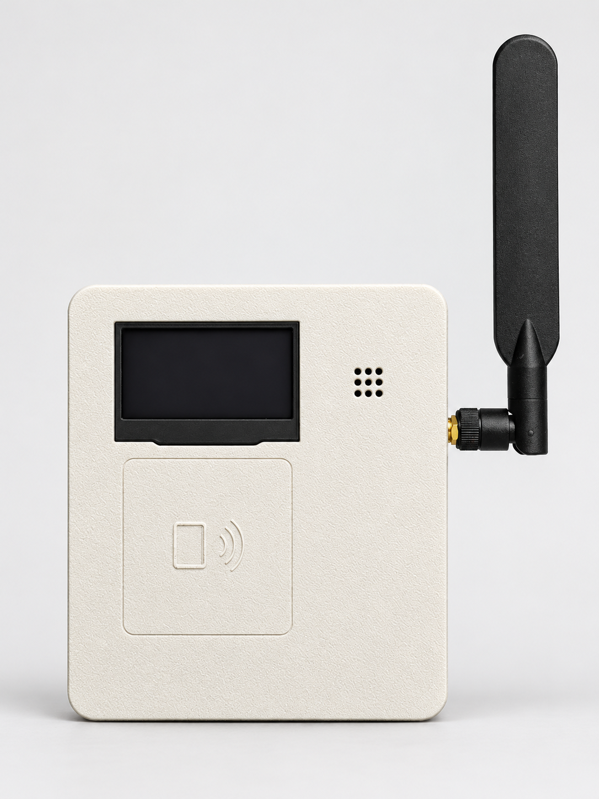
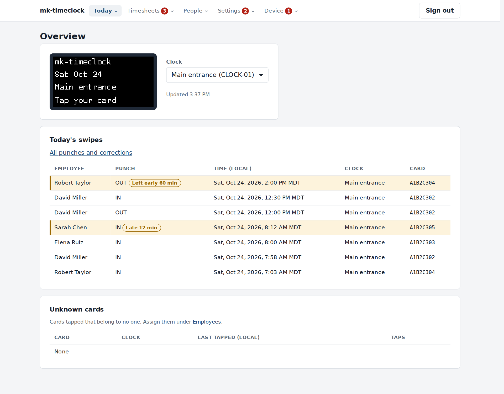
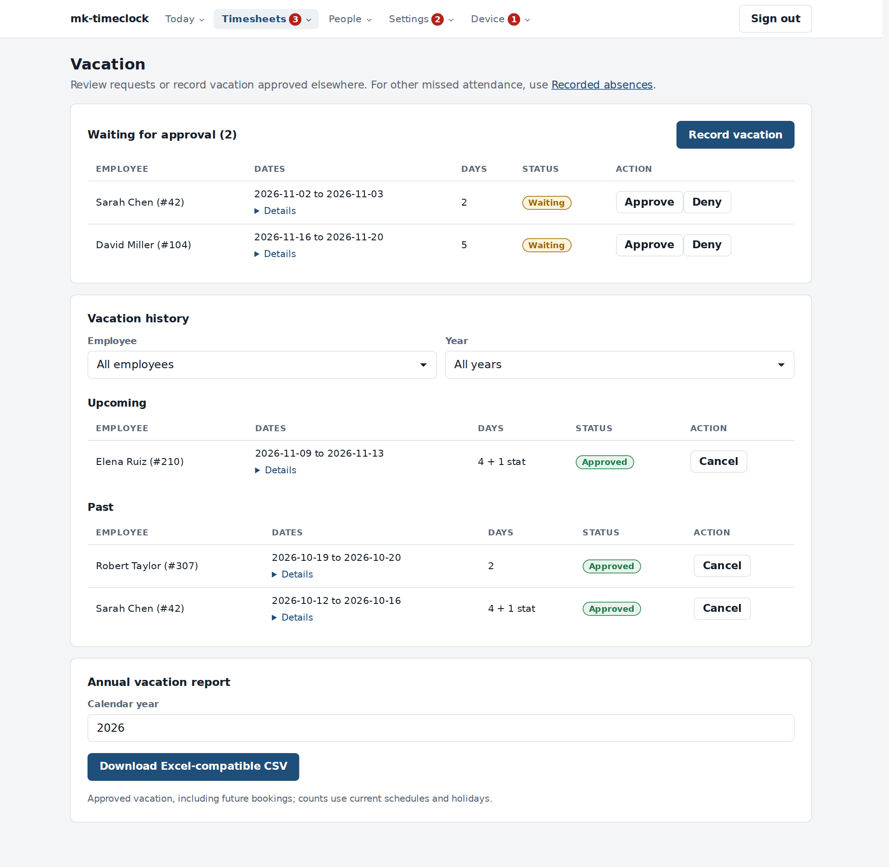
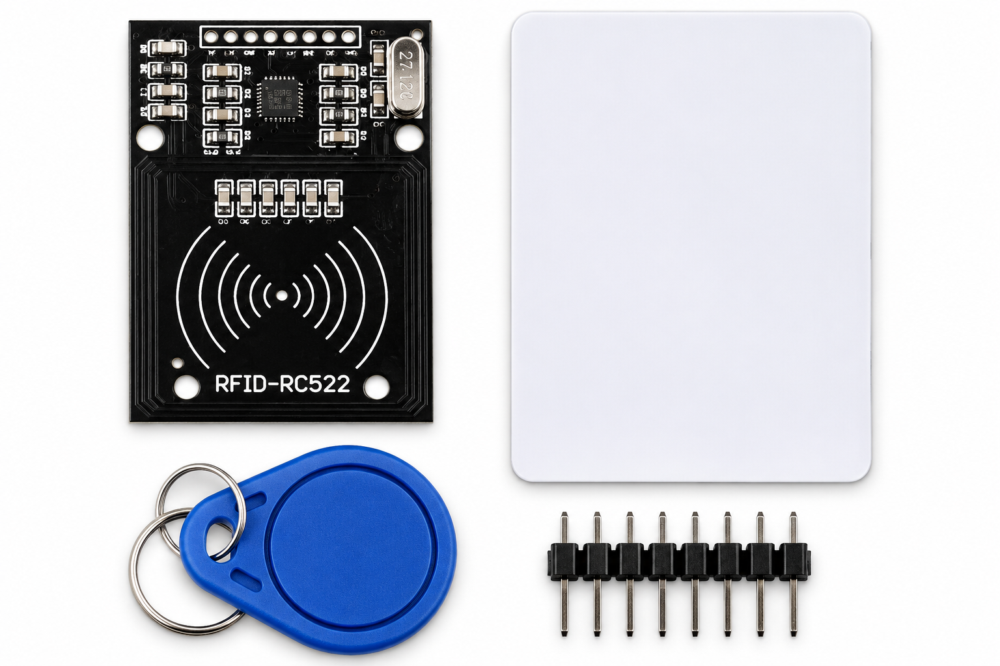
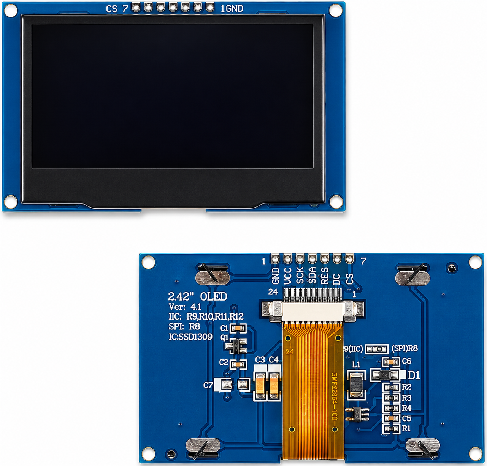
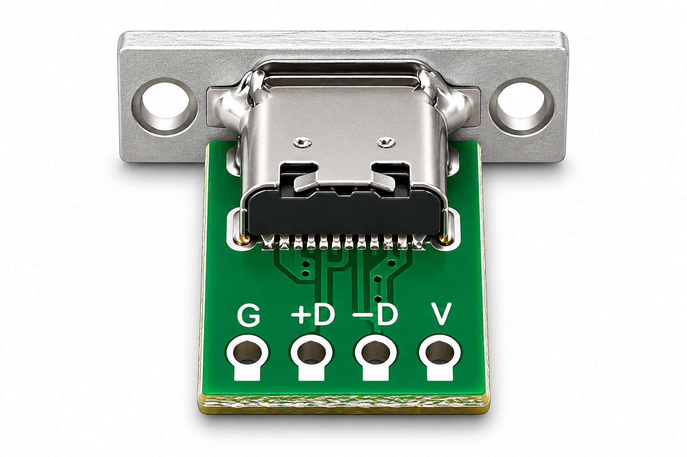
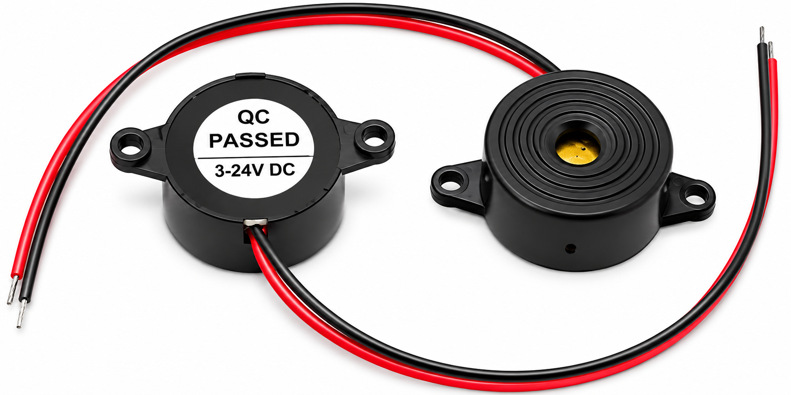
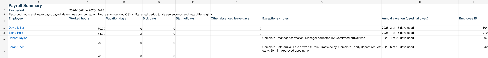
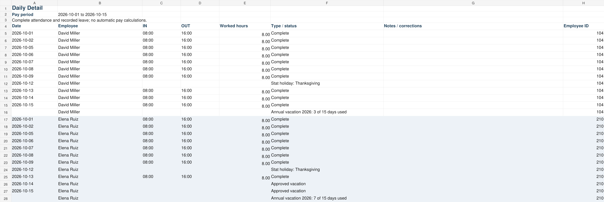
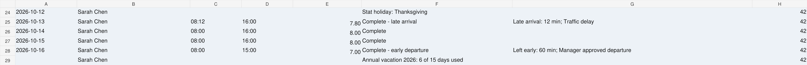

# mk-timeclock Lite

A free, self-hosted RFID employee time clock for the **Banana Pi BPI-M2 Zero**, developed by **iCube Development (Calgary) Ltd.**

Tap a card to clock IN or OUT. Manage attendance and vacation in your browser. Export payroll to Excel or CSV. **No subscription, per-employee fees or required cloud account.**

Attendance is stored locally. Email needs access to your SMTP server; Secondary clocks need a network connection to upload queued punches to the Primary.

Current release: **1.9.5-RC3-cleanup27**.

**[Download the latest mk-timeclock](https://github.com/mkinderwater/mk-timeclock/releases)**

> **Building a clock?** The [Build and Install Guide (PDF)](Timeclock-Build-and-Install-Guide.pdf) has detailed step-by-step instructions, from printing the case to hanging the finished clock on the wall. It needs no previous experience and includes a shopping list, photos, soldering steps, a wiring checklist and troubleshooting.

## The clock

| Front | Back | Inside |
| --- | --- | --- |
|  |  |  |

**External Wi-Fi antenna version**

[](front-external-wifi.png)

The enclosure supports internal or external Wi-Fi antenna builds, selected in the OpenSCAD source before exporting the printable parts.

## The management interface

Screenshots use fictional employees. Click an image to view it full size.

### Review attendance

**See who arrived late or left early, and by how many minutes.** Overview shows today's punches and the clock display, with a link to corrections. Lunch OUT/IN punches remain in the record.

[](overview.png)

### Manage vacation

**Waiting requests come first.** Approve or deny them, record vacation approved elsewhere, and filter upcoming or past bookings by employee and year. Stat holidays are counted separately. Download the annual report as an Excel-compatible CSV.

[](vacation.png)

## Features

### For business owners

- **Attendance:** RFID IN/OUT, names on the display, audible confirmation and a Who is in view.
- **Exceptions:** weekly or dated schedules, grace, late arrivals, early departures and missing punches. Manager corrections and notes are audited.
- **Employees:** name search, company Employee IDs, attendance cards and separate manager cards.
- **Payroll:** weekly, biweekly, twice-monthly or monthly periods; timesheet approval, manager overrides and saved CSV/Excel revisions.
- **Vacation:** requests, approvals, historical entries, annual usage and allowances. Add holidays manually or import CSV.
- **Email:** scheduled timesheet links and payroll reports, editable templates and your SMTP server.
- **Backups:** daily local archives, optional emailed copies, download and restore.

### For installers and resellers

- A Primary hosts management and records. Approved Secondary clocks queue punches during outages and upload when reconnected.
- Install from the prepared OS image and source ZIP.
- Manage clock names, HTTPS certificates, email and device health through the browser.
- Commercial use and redistribution are permitted under [AGPL-3.0](#license).

### For makers and developers

- Common modules, a printable enclosure and documented wiring.
- C, SQLite, Python and shell on Linux.
- Source, build scripts and automated workflow checks included.

**IN starts recorded time. OUT stops it.** Missing punches are flagged, not filled in. There are no automatic break deductions, overtime pay calculations or wage calculations. Payroll decides what is payable.

## Estimated build cost

Budget **C$90–150 per clock**, typically **C$120** at estimated 2026 prices. This includes electronics, microSD, power supply and printed-case material. Shipping, tax, tools, labour and extra cards are additional.

## What you need

The [Build and Install Guide (PDF)](Timeclock-Build-and-Install-Guide.pdf) has the full shopping list, with screw sizes and quantities.

| Component | Specification |
| --- | --- |
| Computer | Banana Pi BPI-M2 Zero |
| Storage | microSD card, 16 GB or larger |
| RFID reader | RC522 / MFRC522 with compatible 13.56 MHz cards or fobs |
| Display | 2.42-inch SSD1309 OLED, 128 × 64, configured for I²C |
| Buzzer | Compatible two-wire active buzzer |
| Power | USB-C power breakout and regulated 5 V, 2 A supply |
| Wi-Fi antenna | Internal: stick-on 2.4 GHz PCB antenna with IPEX/u.FL lead. External: 2.4 GHz antenna with matching bulkhead connector and IPEX/u.FL pigtail |
| Network | 2.4 GHz Wi-Fi |
| Assembly | Jumper wires, headers, fasteners and optional printed case |

### Component photos

Use these images to identify parts. Check your board markings against the wiring tables before connecting power.

| RFID reader and credentials | 2.42-inch OLED display |
| :---: | :---: |
| [](rfid.png) | [](oled.png) |
| **RC522 / MFRC522, 13.56 MHz.** Reader, card, fob and header. | **SSD1309, 128 × 64.** Seven-pin board configured for I²C. |

| USB-C power breakout | Active buzzer |
| :---: | :---: |
| [](usb-c.png) | [](buzzer.png) |
| **USB-C breakout.** Connect `V` and `G` for power. | **Two-wire active buzzer.** Red and black leads. |

PCB layouts vary. Use the [wiring tables](#wiring) and the OLED resistor labels below to identify connections.

### Print the enclosure

**PLA or ASA. ASA recommended. No supports required.**

Case v8.34 uses internal M2 × 5 mm fasteners for the OLED and RC522. Use right-angle headers to fit the enclosure.

Print the [front](https://github.com/mkinderwater/mk-timeclock/blob/main/front.stl) and [back](https://github.com/mkinderwater/mk-timeclock/blob/main/back.stl). View the [assembled model](https://github.com/mkinderwater/mk-timeclock/blob/main/assembled.stl) to see how they fit together.

Place the front with its outside face on the bed, and the back with its flat outside face on the bed. Start from your printer's profile for the material, with a 0.4 mm nozzle, 0.24 mm layers, 3 walls and 20% infill. To regenerate a part, open the [SCAD source](https://github.com/mkinderwater/mk-timeclock/blob/main/bpi_rfid_timeclock_v8_34_two_piece.scad) in OpenSCAD; the standard build uses the published STLs.

**Choose the antenna version before exporting.** Open the SCAD source in OpenSCAD and select the internal or external Wi-Fi antenna option. Render and export the required enclosure parts as STL. For the external version shown above, use the enclosure with the antenna connector opening; check the opening against your bulkhead connector before printing. Changing the SCAD selection does not change the already published STL files.

For wall mounting, print the [wall mounting template](Timeclock-Wall-Mounting-Template.pdf) at 100% / Actual size and check its 80 mm reference before drilling.

## Wiring

The tables below are a quick reference. For step-by-step soldering, the OLED I²C change (including removing the display ribbon to reach R9 to R12), assembly order and a wiring checklist, follow the [Build and Install Guide (PDF)](Timeclock-Build-and-Install-Guide.pdf).


These are **physical pin numbers** on the Banana Pi's 40-pin header. Pin 1 is the square pad nearest the microSD slot; odd pins are on the inner row and even pins along the board edge. Disconnect power while wiring. The reader and display use 3.3 V: **never connect either to a 5 V pin** (2 or 4).

The complete build uses **14 header wires** plus the antenna lead. RC522 IRQ and RST, and OLED RES, DC and CS, stay unconnected.

### Wi-Fi antenna

Choose either antenna arrangement and select the matching enclosure option in the SCAD source:

- **Internal:** use a 2.4 GHz PCB antenna with an IPEX/u.FL lead. Mount it vertically inside the front panel, to the right of the RC522, as shown in the internal photo. Route the lead around the lower edge.
- **External:** use a 2.4 GHz antenna and a matching bulkhead-to-IPEX/u.FL pigtail. Secure the bulkhead connector in the enclosure opening, then attach the antenna outside, as shown in [the external Wi-Fi photo](front-external-wifi.png). Match the antenna and pigtail connector type, including SMA versus RP-SMA.

Both arrangements connect to the gold antenna socket near the Banana Pi’s HDMI connector. Route the coax clear of screw posts and case edges, without sharp bends or pinching.

### RC522: SPI0

| RC522 | BPI pin | Signal |
| --- | ---: | --- |
| 3.3V | 17 | 3.3 V |
| GND | 20 | Ground |
| SDA / SS | 24 | PC3, chip select |
| SCK | 23 | PC2 |
| MOSI | 19 | PC0 |
| MISO | 21 | PC1 |

The RC522's SDA pin is SPI chip select in this setup.

### OLED: I²C0

| OLED | BPI pin | Signal |
| --- | ---: | --- |
| VCC | 1 | 3.3 V |
| GND | 9 | Ground |
| SDA | 3 | PA12 |
| SCL | 5 | PA11 |

For the project's seven-pin SSD1309 PCB, configure I²C:

| Location | Change |
| --- | --- |
| R8 | Remove the 0 Ω resistor |
| R9 | Move the resistor here, or bridge the pads |
| R10, R11, R12 | Bridge the pads |

These labels apply to the project's OLED PCB. R9 to R12 sit under the display's flex ribbon: release the connector's locking bar and slide the ribbon out to reach them, then refit it the same way round and close the bar. Check that no solder bridges neighbouring pads. The display uses address `0x3c`; no reset-wire modification is needed.

### Buzzer

| Buzzer | BPI pin | Signal |
| --- | ---: | --- |
| Positive / control | 7 | PA6 |
| Ground | 6 | Ground |

### USB-C power breakout

| Breakout | BPI pin | Signal |
| --- | ---: | --- |
| VBUS | 2 | 5 V |
| GND | 39 | Ground |

## Install

This is a summary for experienced installers. The [Build and Install Guide (PDF)](Timeclock-Build-and-Install-Guide.pdf) walks through every step in detail, including finding the clock's IP address, copying the ZIP and creating the first manager.

### 1. Write the image

Download the prepared [bpi-zero-wbuild 3.13 image](https://github.com/mkinderwater/bpi-zero-wbuild/releases/tag/3.13):

`bpi-zero-wbuild-3.13-trixie-minimal-hw-bpi-m2-zero.img.gz`

Write it to the microSD card with balenaEtcher. On Windows, cancel any prompt to format the disk.

### 2. Set your credentials

Reinsert the card in your computer. Open `CONFIG.TXT` on the `BPIWBUILD` volume and enter your Wi-Fi and SSH credentials:

```ini
SSID=OfficeWiFi
PSK=your-wifi-password
COUNTRY=CA
HIDDEN=false
TIMEZONE=America/Edmonton
ROOT_PASSWORD=your-ssh-password
```

Use your own values, with no spaces around `=` and no quotation marks. The network must be **2.4 GHz**. `ROOT_PASSWORD` is required, and the clock removes it from `CONFIG.TXT` after first boot, so record it somewhere safe.

**Insert the card into the Banana Pi before mounting the board in the case.** Once the Banana Pi is installed, the buzzer blocks the microSD slot.

When assembly and wiring are complete, connect power. Allow about ten minutes for first boot; the OLED stays blank until the software is installed. Find the clock's IP address in your router and reserve it so it doesn't change.

### 3. Upload and install

[Download the latest mk-timeclock ZIP](https://github.com/mkinderwater/mk-timeclock/releases), then upload it to `/root` on the clock using WinSCP, SFTP or scp. Connect over SSH using the clock's IP address:

```bash
ssh root@192.168.1.50
```

Replace the example IP with your clock's address. Use the `ROOT_PASSWORD` entered in `CONFIG.TXT`.

Unzip the archive and run the installer:

```bash
cd /root
unzip mk-timeclock-lite-RC3-cleanup27.zip
cd mk-timeclock-lite-RC3-cleanup27
./install-master.sh
```

Use the filename from your download. The installer handles dependencies, compilation and service setup; keep the clock powered until it finishes.

### 4. Open the clock

Visit `https://<clock-ip>/setup` and create your manager account. A fresh install uses a self-signed certificate, so a browser warning is expected until you install a trusted one under **Settings**. Tap an unused card within 30 seconds to register it for manager authorization, then sign in at `https://<clock-ip>/login`.

Keep the manager authorization card separate from the manager's own attendance card.

Before closing the case, check that the display shows the time and **TAP YOUR CARD**, the manager card beeps and shows **HELLO MANAGER**, and an unregistered card shows **INVALID CARD**. Then fit the back with 4 × M3 × 12 mm countersunk screws.

## Set up your business

- Add employees, company Employee IDs and attendance cards.
- Assign weekly or dated schedules.
- Configure outgoing email and choose which notifications to send.
- Set the pay schedule and the send times for payroll reports and timesheet links.
- Add holidays and optional annual vacation allowances.

Holiday CSV format:

```csv
Date,Holiday
2026-12-25,Christmas Day
2027-01-01,New Year's Day
```

Use `YYYY-MM-DD` dates. Review imported rows and click **Save holidays**.

## Daily use

Employees tap to clock IN and OUT. Managers use **Punches and corrections** to resolve missing punches, correct times and add notes.

Late arrivals are checked against the scheduled start and grace. Early departures are checked after the scheduled finish plus grace, allowing for lunch and other returns.

Employees request vacation through a private link. Managers approve requests or record earlier approvals, including verbal, emailed and historical vacation. Annual usage shows **X of Y days**. The allowance is a reference, not a limit.

## Payroll

Review and close the pay period, create an export, then send the report when needed. The Excel workbook has two tabs:

- **Payroll Summary:** employee hours, vacation, sick days, stat holidays, other recorded leave and exceptions. Annual vacation shows days used against the allowance, such as **6 of 15 days**.
- **Daily Detail:** dates, actual IN/OUT times, hours, attendance flags and notes. Leave and holidays have separate rows.

Both tabs use the company’s Employee ID, or the clock’s internal ID if none is supplied. Daily Detail groups each employee’s records in a shaded block, with undated rows at the end. Click a Summary name to jump to their detail, or filter by employee or date.

Late and early flags retain the actual times, hours and notes. Corrections and approval overrides show what the manager reviewed.

Worked hours and leave days are separate. Summary hours add the rounded CSV shift hours; email totals use seconds and may differ slightly. An overnight shift belongs entirely to the pay period containing its local IN date.

Changes after closing may require a new export. Saved revisions stay unchanged; emailed workbooks use the saved revision.

### Sample payroll reports

These previews use fictional employees for October 12–16, 2026. Click an image to view it full size.

**Payroll Summary** shows totals, vacation used and allowed, and exceptions. Sarah’s late arrival and early departure appear alongside Robert’s manager correction and override.

[](payroll-summary.png)

**Daily Detail** shows the records behind those totals: Thanksgiving, David’s sick day, Elena’s approved vacation, Robert’s corrected OUT and Sarah’s attendance exceptions.

[](payroll-daily-detail.png)

**Exceptions in detail:** Sarah arrived 12 minutes late on October 13 and left 60 minutes early on October 16. Her actual times, hours and explanations remain beside each shift.

[](payroll-exceptions.png)

## One workplace, multiple clocks

Start with one clock. Add Secondary clocks at other entrances, workshops or buildings as needed. Each runs on its own hardware and connects to the same Primary.

- **One set of records:** the Primary manages employees, cards, schedules, vacation and payroll. Secondary clocks collect punches; they do not maintain separate payroll records.
- **Use any connected clock:** an employee can clock IN at one and OUT at another. The Primary combines their punches into the same attendance record.
- **Keep recording during an outage:** each Secondary caches authorized cards and saves punches locally with their original timestamps. It uploads queued punches when the Primary is reachable again. Card changes take effect after the Secondary next refreshes its cache.
- **Know where a punch came from:** records retain the source clock. Give clocks names such as Main entrance or Workshop.
- **Keep management central:** review attendance, correct punches and export payroll from the Primary. If it is unavailable, Secondary clocks can queue punches, but management and reporting wait for it to return.

The intended scale is a small business with one or several clock locations. Capacity depends on punch volume, report workload, network and Primary hardware. Employee and clock capacity have not been load-tested. The current management list displays up to **100 registered clocks**; this is a display limit, not a capacity rating.

### Add a Secondary

Install the same OS image and upload the source ZIP, then run:

```bash
./install-slave.sh
```

Generate an adoption code on the Primary, enter it on the Secondary's setup page and approve the request on the Primary. Each Secondary needs network access to the Primary to register, refresh cards and upload punches.

## Backups and upgrades

The Primary keeps the latest **30 local backups**, created daily around **02:15**. Manual backups count toward the same limit. Use **Backup and restore** to download or restore an archive.

For an upgrade, upload and extract the new ZIP, then rerun `./install-master.sh` from its directory. Use `install-slave.sh` on a Secondary. Existing configuration and data are preserved.

## Documentation

PDF manuals and templates:

- [Employee guide](Timeclock-Employee-Guide.pdf)
- [Manager guide](Timeclock-Manager-Guide.pdf)
- [Build and install guide](Timeclock-Build-and-Install-Guide.pdf)
- [Wall mounting template](Timeclock-Wall-Mounting-Template.pdf)

Technical documentation:

- [Installation and roles](docs/INSTALLATION.md)
- [Manager operations](docs/OPERATIONS.md)
- [Attendance and payroll rules](docs/ATTENDANCE_PAYROLL.md)
- [Backup and restore](docs/BACKUP_RESTORE.md)
- [Development and testing](docs/TESTING.md)

## License

mk-timeclock Lite is free software licensed under the **GNU Affero General Public License, version 3 (AGPL-3.0)**. See [LICENSE](LICENSE) for the full terms.

Personal, internal business and commercial use are permitted. You may inspect, modify and redistribute the software under the license.

When redistributing covered software, retain required notices and provide Corresponding Source as the license requires. If you modify the program and let users interact with it over a network, prominently offer those users the modified version's Corresponding Source at no charge.

Employee information, attendance records, payroll exports and backups do not become public merely because you use this software. Third-party components retain their own licenses.

AGPL was chosen to keep the clock free software and make modified network versions' source available to their users. The software is supplied without warranty, to the extent permitted by law.

## Contributions

Issues and contributions are welcome. Include the version, clock role and steps to reproduce a problem. Remove employee details, passwords, card IDs and private links from public reports.

